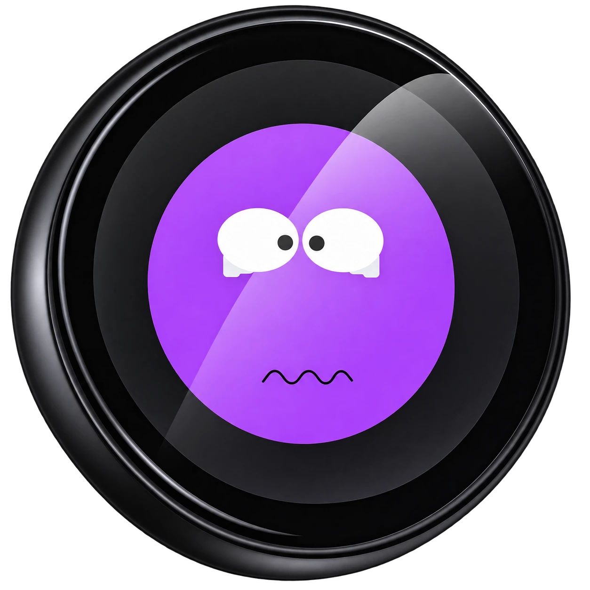

<p align="center">
  
</p>

# ZNP-RE

**The ZNP Z01 AI badge, reverse engineered.** The full Bluetooth protocol and working iOS and Android code, so you can build your own badge assistant with your own app, features and AI model.

We use it with [Claude](https://www.anthropic.com/claude), but you can plug in any model.

```
press the badge ─▶ speak ─▶ your phone app ─▶ Claude ─▶ answer on the badge screen
                                                      └▶ and out of the badge speaker
```

## The Z01 is just a mic and a speaker

Under the "AI" label, the Z01 is a microphone, a speaker, a small round screen, one button and a Bluetooth chip. Same parts as a cheap smartwatch, and the chip comes from the same family.

There's no AI inside. The badge records your voice, sends it to a phone app over Bluetooth, and shows or plays whatever comes back. Whoever controls the app controls the badge, and this repo gives you that control.

You can buy one on [AliExpress](https://www.aliexpress.com/item/1005013174192186.html).

## The stock app is not great

The Z01 ships with an app called **BagiBagi**, and it wastes the hardware.

- "Add a GIF" uploads a single frozen frame. We decoded the badge's real animation format, so you can push moving faces to the screen.
- You can't choose the AI model, the voice or the personality.
- It can only chat. No email, calendar, music or directions.
- Your voice goes through their servers.
- It's closed source.

## Meet Milo

**Milo** is my own assistant, built on the protocol in this repo. It replaces BagiBagi on my Z01.

I use it for small tasks that would otherwise mean unlocking my phone. I double-tap the badge and ask "what's in my calendar tomorrow?" or "play something calm", and the answer shows on the badge and plays through its speaker.

<p align="center">
  
</p>

What Milo does:

- Answers with Claude, streamed to the badge screen word by word and read out loud
- Sends email, reads and adds calendar events, places calls, plays music, and types for me with its own keyboard
- Keeps listening after each answer in conversation mode
- Runs common commands instantly with a small on-device model
- Shows turn-by-turn directions on the badge, like `<< LEFT 200 m`
- Hands off to other apps (Maps, Waze, Spotify) with a lock-screen card
- Uses a custom listening screen and animated faces
- Has no account and no server. Voice is transcribed on the iPhone when the language allows, and the iPhone's own mic is never used

## What's in this repo

- [PROTOCOL.md](docs/PROTOCOL.md). The full BLE protocol, byte by byte.
- [HOW-WE-DID-IT.md](docs/HOW-WE-DID-IT.md). The reverse engineering, in plain words.
- [FILE-FORMATS.md](docs/FILE-FORMATS.md). Pictures and animated faces for the screen.
- [examples/ios](examples/ios). A Swift package (`Z01Kit`) and a small SwiftUI app wired to Claude.
- [examples/android](examples/android). The same in Kotlin.
- [tools/z01_probe.py](tools/z01_probe.py). Drive the badge from your laptop with Python.

## Why build your own

With your own app, the badge can do anything your phone can do. A pocket assistant, a translator, a note taker, a remote for your smart home.

Meta's **Charm keychain**, an AI you wear, is scheduled to ship in December 2026. A Z01 and this repo get you the same idea today, with your model, your features and your data.

| | BagiBagi | Your app |
|---|---|---|
| AI model | fixed | Claude, another provider, or a local model |
| Features | chat | anything you can write as a tool |
| Animations | GIFs freeze | real animated faces |
| Privacy | vendor's servers | badge → your phone → the model you chose |
| Code | closed | open, MIT |

It's also easy to build on:

- **Nothing to flash.** The firmware stays stock, so you can't brick the badge.
- **Music keeps playing.** The mic comes over BLE as data, not as a phone call.
- **Any voice works.** The speaker is a normal Bluetooth audio output named "Z01".
- **Text streams live.** Answers appear on the screen while the model is still writing.

## Try it from your laptop

Turn the badge on and close the stock app on your phone, since only one app can hold the badge. Then, from the repo folder:

```bash
python3 -m venv .venv
```

```bash
.venv/bin/python -m pip install --upgrade pip
```

```bash
.venv/bin/pip install bleak
```

```bash
.venv/bin/python tools/z01_probe.py --text "Hello from my laptop"
```

The badge connects, unlocks and shows your text. Add `--listen`, press the badge button and talk, and the probe saves what the badge heard.

> **On a Mac,** upgrade pip on its own first, as above. The `python3` that ships with macOS has an old pip that tries to compile `pyobjc-core` and fails with *Cannot locate a working compiler*. Allow Bluetooth access for your terminal when asked.

## Build your own app

**iOS.** Follow [examples/ios](examples/ios). Create an app in Xcode, add the `Z01Kit` package, copy in the five Swift files from [examples/ios/QuickStart](examples/ios/QuickStart), paste your Anthropic API key and run. The core loop looks like this.

```swift
import Z01Kit

let badge = Z01()
let listener = Listener()               // speech to text, QuickStart/Listener.swift
let claude = Claude(apiKey: myKey)      // streaming client, QuickStart/Claude.swift

badge.onEvent = { event in
    switch event {
    case .buttonPressed:                // 1. the wearer presses the button
        listener.start { _ in }
        badge.startMic()
    case .micAudio(let pcm):            // 2. the badge streams what it hears
        listener.append(pcm)
    default:
        break
    }
}
badge.start()

// 3. when they stop talking (the QuickStart app waits for 1.2 s of silence)
func answer() async throws {
    badge.stopMic()
    badge.setScreen(.thinking)
    let question = listener.stop()
    badge.beginReply()
    for try await piece in claude.stream(system: "Answer in one short spoken sentence.",
                                         messages: [.init(role: "user", text: question)]) {
        badge.appendReply(piece)        // 4. the answer appears on the badge as it's written
    }
}
```

**Android.** Follow [examples/android](examples/android). Same structure in Kotlin, with the official Anthropic Java SDK.

**Anything else.** It's plain BLE, so Flutter, React Native, a Raspberry Pi or an ESP32 can drive the badge too. Start from [PROTOCOL.md](docs/PROTOCOL.md) and the Python probe.

## The protocol at a glance

| | Channel | Bytes |
|---|---|---|
| unlock | `AE01` / `AE02` | JieLi challenge-response, solved by reflecting the badge's own challenge |
| button pressed | ← `AE02` | RCSP op `FF`, `FF F7 F1 00` |
| open mic | → `AE01` | RCSP op `04`, `02 10 00` |
| voice | ← `AE02` | RCSP op `01`, Opus packets, 16 kHz mono, 20 ms |
| close mic | → `AE01` | RCSP op `05`, `00` |
| screen | → `AE01` | RCSP op `FF`, `FF F7 F1 02` replying, `03` listening, `04` thinking |
| text | → `DF98` | `88 88 11 01 …`, 2 characters per frame, acked on `DF99` |
| battery | → `AE01` | RCSP op `03`, `FF FF FF FF` |
| speaker | classic Bluetooth | a normal audio output named `Z01` |

Timings and gotchas are in [PROTOCOL.md](docs/PROTOCOL.md).

## Status

| | |
|---|---|
| Connect, unlock, button, mic, screens, text | works on real badges |
| Pictures and animation packs | works on real badges, documented here, no sample code yet |
| iOS `Z01Kit` | unit-tested, trimmed from the code our iOS apps run on real badges |
| iOS QuickStart app | compiles against the iOS SDK |
| Android quick start | a port, not yet compiled or tried on a badge |

Open questions are listed at the end of [PROTOCOL.md](docs/PROTOCOL.md#16-what-is-still-unknown).

## Contributing

Issues and pull requests are welcome, especially captures from other firmware versions, answers to the open questions, Android testing and ports to other platforms.

## Disclaimer

An independent interoperability project by owners of the device, not affiliated with ZNP, JieLi, Anthropic or Meta. No firmware was modified and no keys or encryption were extracted. Opinions about the stock app are our own. Use at your own risk.

## License

[MIT](LICENSE)
