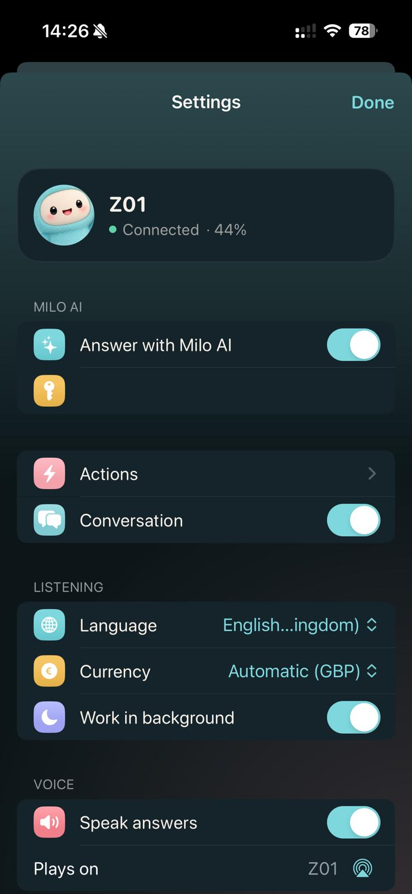

<p align="center">
  
</p>

# ZNP-RE

**The ZNP Z01 AI badge, reverse engineered.** The complete Bluetooth protocol, plus working iOS and Android code, so you can build your own AI badge assistant with your own app, your own features and the AI model you choose.

We use it with [Claude](https://www.anthropic.com/claude). You can plug in anything, and build literally any feature you can think of.

```
press the badge ─▶ speak ─▶ your phone app ─▶ Claude ─▶ the answer on the badge screen
                                                      └▶ and out of the badge speaker
```

---

## The Z01 is just a mic and a speaker

Take the "AI" label off the Z01 and what's left is simple hardware: a **microphone**, a **speaker**, a small round screen, one button and a Bluetooth chip. It's the same set of parts as a basic cheap smartwatch, and the chip comes from the same family.

There's no AI inside. The badge only records your voice, sends it to a phone app over Bluetooth, and shows or plays whatever comes back. The intelligence was always in the app and the cloud service behind it.

So whoever controls the app controls the badge. This repo gives you that control.

### Get one

The Z01 sells on AliExpress: [ZNP Z01 AI badge](https://www.aliexpress.com/item/1005013174192186.html). It's cheap hardware, and that's the point: all the value comes from the app you put behind it.

## The stock app is garbage

The Z01 ships tied to an app called **BagiBagi**, and it wastes the hardware completely:

- **"Add a GIF" doesn't animate.** The app offers to put a GIF on the badge, then uploads it as a single frozen frame. We decoded the badge's own animation format ([FILE-FORMATS.md](docs/FILE-FORMATS.md)), so you can push real moving faces to the screen.
- **The AI is whatever they picked.** You can't choose the model, the voice or the personality.
- **It can only chat.** No email, no calendar, no music, no smart home, no directions.
- **Your voice goes through their servers**, and you get no say in it.
- **It's closed.** You get what they give you, and nothing more.

The hardware is nice: a mic, a screen and a speaker you clip on. Replace the app and it becomes a real assistant. Our version works better on every point above.

## Meet Milo

**Milo** is my own assistant, built on exactly the protocol in this repo. It replaces BagiBagi on my Z01, and it shows what the badge can do with a real app behind it.

I use it for small tasks that would otherwise mean unlocking my phone. I double-tap the badge and ask: "what's in my calendar tomorrow?", "add lunch with Sam on Friday at one", "play something calm". The answer appears on the badge and is read out through its speaker.

### The Milo app: settings

<p align="center">
  
</p>

What Milo does:

- **Answers with Claude.** Double-tap, speak, and the reply streams onto the badge screen word by word while the badge speaker reads it out.
- **Real actions, not just chat.** Email, calendar (read and add events), phone calls, music, and typing for me through its own iPhone keyboard. Each action gets a short spoken confirmation.
- **Conversation mode.** After each answer the badge listens again, so I can keep talking. A double-tap interrupts, silence ends it.
- **Fast local commands.** A small model trained on-device decides whether a request is a quick action it can run straight away, or one that needs Claude.
- **Turn-by-turn directions on the badge.** Apple Maps plans the route and the badge shows `<< LEFT 200 m` before each turn.
- **Lock-screen hand-off.** When an action needs another app (a call, Google Maps, Waze, Spotify), Milo puts a card on the lock screen to tap.
- **Its own character.** A custom listening screen and animated faces, uploaded with the file formats documented here.
- **Works in the background,** in my language and currency, with the voice playing on the Z01.
- **Private by design.** No Milo account and no Milo server. My voice is transcribed on my iPhone when the language allows, and requests go straight to Claude. The iPhone's own mic is never used.

Everything Milo does starts from the code and the protocol in this repo. Want to know more about Milo, or build something like it? Email me at [nizar.bousebsi@gmail.com](mailto:nizar.bousebsi@gmail.com).

## What you get

- **[The full BLE protocol](docs/PROTOCOL.md):** connecting, unlocking, the button, the microphone, the screens, text, files and uploads, byte by byte.
- **[How we did it](docs/HOW-WE-DID-IT.md):** the reverse engineering in plain words, and how we swapped the stock AI for Claude.
- **[An iOS quick start](examples/ios):** a Swift package (`Z01Kit`) and a small SwiftUI app. Press the button, talk, and Claude answers on the badge.
- **[An Android quick start](examples/android):** the same in Kotlin.
- **[A desktop probe](tools/z01_probe.py):** drive the badge from your laptop with Python in two minutes.
- **[File formats](docs/FILE-FORMATS.md):** push your own pictures and animated faces to the screen.

## Why build your own

The Z01 is a small, wearable mic and speaker. Pair it with your own app and you can make it do **literally anything**: a pocket assistant, a translator, a note taker, a kid-friendly talking toy, a hands-free remote for your whole digital life. If your phone can do it and an AI can decide when, the badge can trigger it.

Meta's **Charm keychain**, an AI you wear, is scheduled to start shipping in December 2026. You don't have to wait for it, or accept the features Meta decides to give you. With a Z01 and this repo you can build the same idea today, and make it better: your model, your features, your data, your rules. The same goes for any other AI badge or talking toy on the market.

| | Stock app (BagiBagi) | Your app |
|---|---|---|
| **AI model** | whatever the vendor picked | any: Claude Opus, Sonnet or Haiku, or another provider, or a local model |
| **Features** | chat | anything you can write as a tool: email, calendar, music, smart home, directions, your own APIs |
| **Animations** | GIFs upload as a frozen frame | real animated faces, your own designs |
| **Privacy** | your voice goes through the vendor's servers | badge → your phone → the AI provider you chose. No extra account, no middleman |
| **Cost** | tied to the vendor's service | the badge, plus what you use of your AI provider |
| **Personality** | fixed | your prompt, your voice, your faces on the screen |
| **Code** | closed | open, MIT |

A few more things that make it pleasant to build on:

- **Nothing to flash.** The firmware stays stock. You can't brick the badge, and the stock app still works if you go back.
- **The mic doesn't hijack your audio.** Voice comes over BLE as data, not as a phone call profile, so music keeps playing while you talk.
- **The speaker is just Bluetooth audio.** Pick "Z01" as the output and any text-to-speech engine plays through it.
- **The screen shows text as it streams.** Answers appear word by word while the model is still writing.

## Try it in two minutes (from your laptop)

Turn the badge on and close the stock app on your phone (only one app can hold the badge). Then, from the repo folder, set up a virtual environment:

```bash
python3 -m venv .venv
```

Upgrade its pip first, on its own:

```bash
.venv/bin/python -m pip install --upgrade pip
```

```bash
.venv/bin/pip install bleak
```

```bash
.venv/bin/python tools/z01_probe.py --text "Hello from my laptop"
```

> **On a Mac,** don't skip the pip upgrade. The `python3` that ships with macOS and Xcode has an old pip. It tries to compile `pyobjc-core` from source and fails with *Cannot locate a working compiler*. An up-to-date pip installs ready-made packages instead. The first run asks for Bluetooth permission for your terminal: allow it.

The badge connects, unlocks and shows your text. Add `--listen`, press the badge button and talk: the probe saves what the badge heard.

## Build your own app

### iOS

Follow [examples/ios](examples/ios). In short: create an iOS app in Xcode, add the local `Z01Kit` package, drop in the five QuickStart files, paste your Anthropic API key, run.

The heart of it fits on one screen:

```swift
import Z01Kit

let badge = Z01()
let listener = Listener()               // speech to text, QuickStart/Listener.swift
let claude = Claude(apiKey: myKey)      // streaming client, QuickStart/Claude.swift

badge.onEvent = { event in
    switch event {
    case .buttonPressed:                // 1. the wearer presses the button
        listener.start { _ in }
        badge.startMic()
    case .micAudio(let pcm):            // 2. the badge streams what it hears
        listener.append(pcm)
    default:
        break
    }
}
badge.start()

// 3. when they stop talking (the QuickStart app waits for 1.2 s of silence)
func answer() async throws {
    badge.stopMic()
    badge.setScreen(.thinking)
    let question = listener.stop()
    badge.beginReply()
    for try await piece in claude.stream(system: "Answer in one short spoken sentence.",
                                         messages: [.init(role: "user", text: question)]) {
        badge.appendReply(piece)        // 4. the answer appears on the badge as it's written
    }
}
```

### Android

Follow [examples/android](examples/android). Same structure in Kotlin: `Z01Link` for the badge, Android's `MediaCodec` for the audio, the official Anthropic Java SDK for Claude.

### Anything else

The protocol is plain BLE. Flutter, React Native, a Raspberry Pi or an ESP32 can all drive the badge. [PROTOCOL.md](docs/PROTOCOL.md) has everything, and the Python probe is a compact reference.

## The protocol at a glance

| | Channel | Bytes |
|---|---|---|
| unlock | `AE01` / `AE02` | JieLi challenge-response, solved by reflecting the badge's own challenge |
| button pressed | ← `AE02` | RCSP op `FF`, `FF F7 F1 00` |
| open mic | → `AE01` | RCSP op `04`, `02 10 00` |
| voice | ← `AE02` | RCSP op `01`, Opus packets, 16 kHz mono, 20 ms |
| close mic | → `AE01` | RCSP op `05`, `00` |
| screen | → `AE01` | RCSP op `FF`, `FF F7 F1 02` replying, `03` listening, `04` thinking |
| text | → `DF98` | `88 88 11 01 …`, 2 characters per frame, acked on `DF99` |
| battery | → `AE01` | RCSP op `03`, `FF FF FF FF` |
| speaker | classic Bluetooth | a normal audio output named `Z01` |

The full details, timings and gotchas are in [docs/PROTOCOL.md](docs/PROTOCOL.md).

## Ideas

- A translator: speak in one language, read the answer in another on the screen.
- A memory badge: "remember that I parked on level 3", then ask later.
- A kids' companion with a gentle persona and your own animated face.
- A meeting note taker that sends you a summary afterwards.
- A home controller: "turn off the living room lights".
- A fully offline assistant on a local model.

## Repository layout

```
docs/
  PROTOCOL.md         the BLE protocol, byte by byte
  HOW-WE-DID-IT.md    the reverse engineering, in plain words
  FILE-FORMATS.md     pictures, animation packs, videos
examples/
  ios/                Z01Kit (Swift package) + a SwiftUI quick-start app
  android/            the same in Kotlin
tools/
  z01_probe.py        drive the badge from a computer (Python + bleak)
```

## Status

| | |
|---|---|
| connect, unlock, reconnect | works on real badges |
| button, mic, screens, text | works on real badges |
| pictures, animation packs | works on real badges. Documented here, no sample code yet |
| iOS `Z01Kit` | unit-tested. A trimmed-down copy of the code our iOS apps run on real badges |
| iOS QuickStart app | compiles against the iOS SDK |
| Android quick start | a port, not yet compiled or tried on a badge |

What's still unknown is listed at the end of [PROTOCOL.md](docs/PROTOCOL.md#16-what-is-still-unknown).

## Contributing

Issues and pull requests are welcome, especially:

- captures from other firmware versions or other JieLi badges,
- the unknowns listed in the protocol doc,
- testing and fixes for the Android sample,
- ports to other platforms.

## Contact

Questions, ideas, or want to know more about Milo? Reach me directly at [nizar.bousebsi@gmail.com](mailto:nizar.bousebsi@gmail.com).

## Disclaimer

This is an independent project for interoperability, made by owners of the device. It isn't affiliated with or endorsed by ZNP, JieLi, Anthropic or Meta. No firmware was modified, and no keys or encryption were extracted or broken. What we say about the stock app is our own opinion, from using it. Product names belong to their owners. Use it at your own risk.

## License

[MIT](LICENSE)
